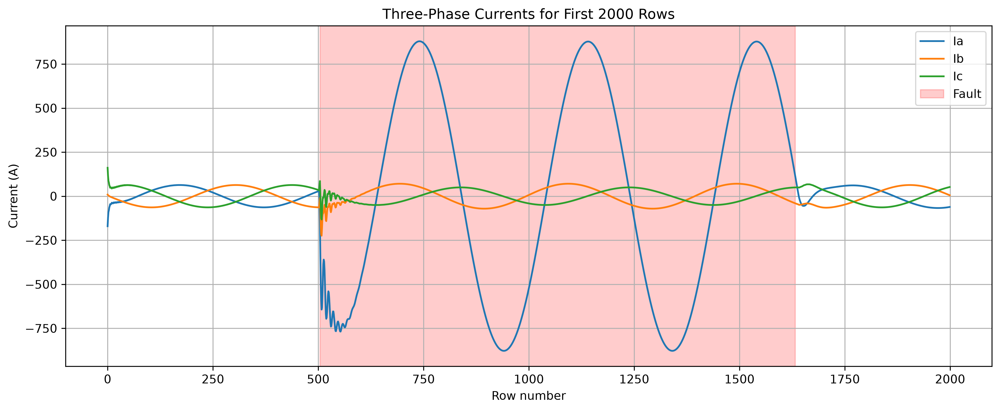
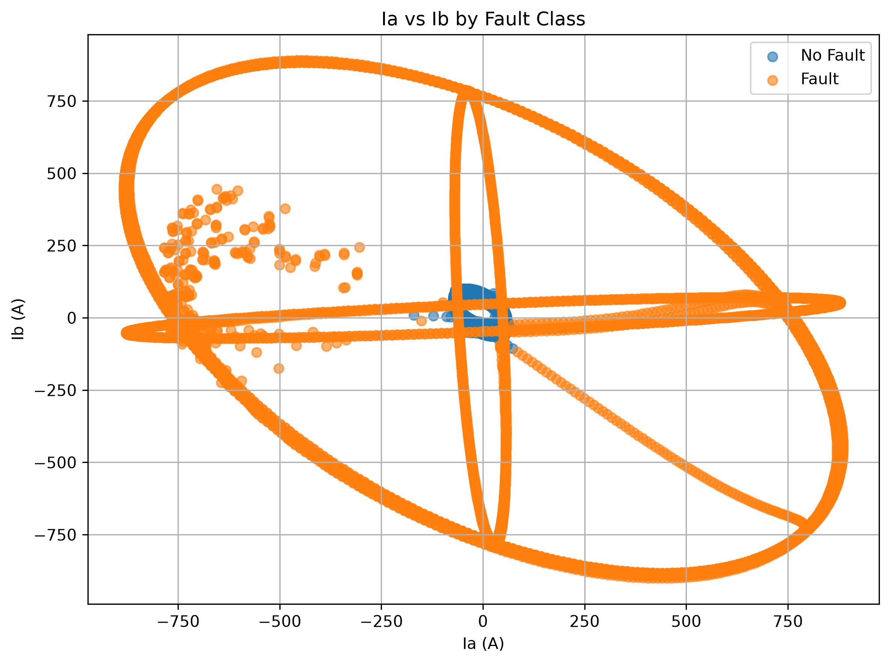
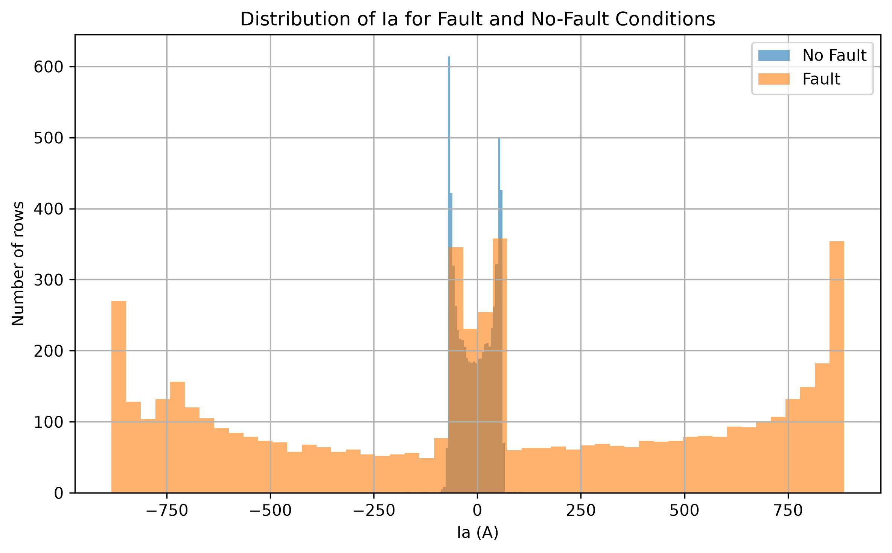
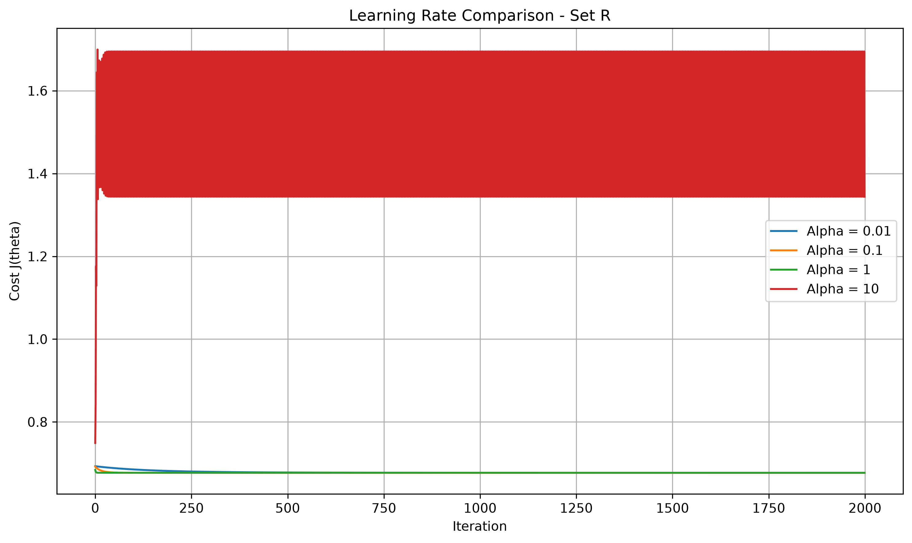
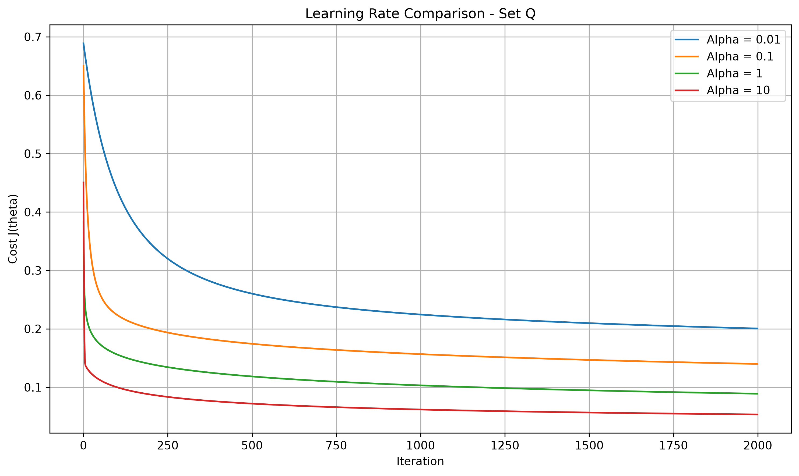
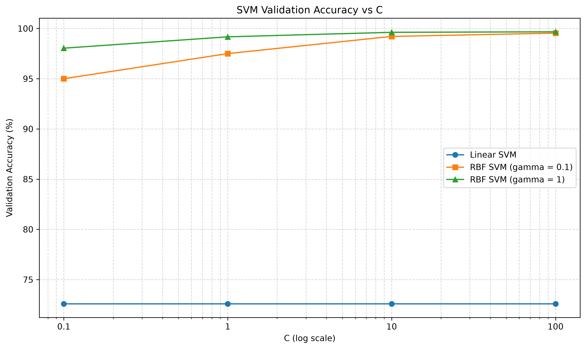
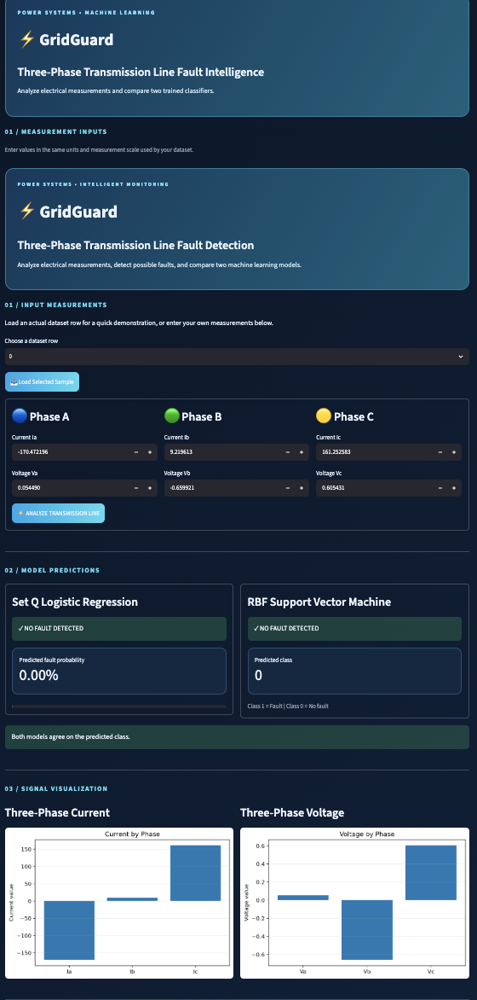

# ⚡ Electrical Fault Detection Using Machine Learning

A machine learning project for detecting faults in three-phase electrical transmission lines using Logistic Regression and Support Vector Machines (SVM).

## 📌 Project Overview

Electrical faults can affect power system reliability, damage equipment, and interrupt electricity supply. This project uses three-phase electrical measurements to classify transmission line conditions as **fault** or **no fault**.

The project includes data exploration, feature engineering, model training, validation, testing, and a Streamlit-based interface.

## 🎯 Objectives

- Explore and prepare the electrical fault dataset.
- Implement Logistic Regression with two feature sets.
- Train and compare Linear SVM and RBF SVM models.
- Evaluate performance using accuracy and confusion matrices.
- Build a simple interface for interacting with the trained models.

## 🛠️ Technologies Used

- Python
- NumPy and Pandas
- Matplotlib
- Scikit-learn
- Joblib
- Streamlit
- Git and GitHub

## 📊 Dataset

The dataset is stored at `data/detect_dataset.csv`.

It contains three-phase electrical measurements, including current and voltage features, with a target label representing the fault condition.

## 🤖 Models Implemented

1. **Logistic Regression — Set R:** Uses the original electrical features.
2. **Logistic Regression — Set Q:** Uses original features and squared features.
3. **Linear SVM:** Classifies observations using a linear decision boundary.
4. **RBF SVM:** Uses a nonlinear decision boundary with hyperparameter tuning.

## 📈 Test Results

| Model | Test Accuracy |
|---|---:|
| Logistic Regression — Set R | 72.64% |
| Logistic Regression — Set Q | 97.88% |
| Linear SVM | 73.59% |
| RBF SVM | 99.58% |

The RBF SVM achieved the highest test accuracy among the evaluated models. For electrical protection applications, missed faults and false alarms must also be considered before selecting a model for deployment.

## 📉 Exploratory Data Analysis

### Current Distribution by Fault Class



### Current Feature Relationships



### Current Histograms



## 🧪 Model Validation

### Logistic Regression — Set R



### Logistic Regression — Set Q



### SVM Validation Accuracy



## 🖥️ Application Preview



## 🚀 Installation and Usage

### 1. Clone the Repository

```bash
git clone https://github.com/mirzaabdulrehmanieee-xyz/Electrical-Fault-Detection-using-ML.git
cd Electrical-Fault-Detection-using-ML
```

### 2. Install Dependencies

```bash
python3 -m pip install numpy pandas matplotlib scikit-learn joblib streamlit
```

### 3. Explore the Dataset

```bash
python3 src/eda.py
```

### 4. Train Logistic Regression

```bash
python3 src/train_logistic.py
```

### 5. Train SVM Models

```bash
python3 src/train_svm.py
```

### 6. Generate the SVM Validation Plot

```bash
python3 src/plot_svm_results.py
```

### 7. Evaluate the Models

```bash
python3 src/test_models.py
```

### 8. Launch the Streamlit Application

```bash
python3 -m streamlit run app.py
```

Open the local URL displayed in the terminal.

## 📁 Project Structure

```text
Electrical-Fault-Detection-using-ML/
├── data/
│   └── detect_dataset.csv
├── results/
│   ├── figures/
│   ├── Tables/
│   ├── analysis.md
│   ├── svm_results.md
│   ├── best_linear_svm.joblib
│   ├── best_rbf_svm.joblib
│   ├── theta_Q.txt
│   └── theta_R.txt
├── src/
├── app.py
├── README.md
└── .gitignore
```

## 🔍 Key Findings

- Feature engineering substantially improved Logistic Regression performance.
- The Linear SVM performed similarly to Logistic Regression using the original features.
- The RBF SVM achieved the highest test accuracy in this experiment.
- Confusion matrices are important for understanding false alarms and missed faults.

## ⚠️ Limitations

The results depend on the dataset, preprocessing, and train-validation-test split. Further testing on independent operating conditions is needed before considering deployment in a real power system protection relay.

### 👨‍💻 Authors

**1. Mirza Abdul Rehman**  
Electrical Engineering Student

**2. Muhammad Wasiq Aslam**  
Electrical Engineering Student

## 📄 License

No license has been specified for this repository yet.
## Model Comparison

| Model | Test Accuracy | False Alarms | Missed Faults |
|---|---:|---:|---:|
| Logistic Regression (Set R) | 72.64% | 0 | 657 |
| Logistic Regression (Set Q) | 97.88% | 6 | 45 |
| Linear SVM | 73.59% | 0 | 634 |
| RBF SVM | 99.58% | 4 | 6 |

The RBF SVM achieved the highest test accuracy among the evaluated models. However, the test results may be optimistic because the dataset contains consecutive time samples and was randomly split. Independent testing is needed before practical deployment.
